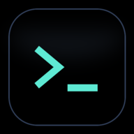

# DSH 控制台 · NEXT

用手机监控和控制你的开发服务器 —— **液态玻璃界面**、状态面板、Web 终端、文件管理、实时日志。

<p align="center">
  
</p>

> **⚠️ 这是 NEXT 分支**：基于 Flutter 的完全重写版，使用 `liquid_glass_renderer` 实现 iOS 27 风格的液态玻璃底栏。
> 稳定的原生 Android（MD3）版在 [`main`](../../tree/main) 分支。

---

## 这是什么

一个 Flutter Android 客户端 + 一个轻量 Node 后端，让你在手机上：

- **看** 服务器状态：CPU / 内存 / 磁盘 / 温度 / 负载 / 守护进程
- **敲** 命令：内嵌 Web 终端（ttyd），带自定义按键条
- **传** 文件：原生文件浏览器，浏览 / 下载
- **盯** 编译：实时编译日志推送
- **收** 消息：服务端推送通知
- **诊** 一键诊断：跑完自动格式化输出

---

## 液态玻璃底栏

NEXT 分支的核心特性。基于 [`liquid_glass_renderer`](https://pub.dev/packages/liquid_glass_renderer) 的真实折射着色器：

- **默认收缩**成一个 50×50 的小圆胶囊，只显示当前 tab 图标
- **点击展开**成 5 图标底栏，320ms 缓动动画
- **图标自放大**：滑块接近时该图标放大 1.45× 并向上抬 3dp
- **浮动标签**：滑动时名字浮在底栏上方（不进玻璃，所以清晰）
- **一碰即收**：展开状态下触摸内容区自动收起，且事件不丢失

设置页可调 10+ 个玻璃参数（底栏高度、放大倍率、色调、模糊、折射、轮廓、斜面、动画时长/曲线…），全部持久化。

> ⚠️ **需要 Impeller + Flutter GPU**。Android 端通过 `AndroidManifest.xml` 的
> `io.flutter.embedding.android.EnableFlutterGPU = true` 开启。
> 不支持 Flutter GPU 的设备会自动回退到 `FakeGlass`（静态近似，无折射）。

---

## 快速开始

### 1. 后端

```bash
cd server
npm install
node server.js          # 默认监听 18800
```

### 2. 客户端

```bash
flutter pub get
flutter build apk --release
```

首次启动会弹出开源声明，然后需要手动填服务器地址：

```
设置 → ① 服务器 → 主机地址
  Tailscale:  100.x.x.x
  局域网:      192.168.x.x
```

---

## 技术栈

| 层 | 技术 |
|---|---|
| UI | Flutter 3.47 + Material 3 |
| 玻璃 | `liquid_glass_renderer` 1.0（Impeller + Flutter GPU） |
| 终端 | `webview_flutter` + ttyd |
| 文件 | 原生列表 + `url_launcher` |
| 后端 | Node.js（零依赖，单文件） |

---

## 目录结构

```
lib/
  main.dart              入口 + 主框架 + 玻璃底栏集成
  settings.dart          设置持久化（含玻璃参数）
  theme.dart             字体与标题样式
  models/snapshot.dart   /progress 数据结构
  api/api_client.dart    后端接口封装
  state/console_state.dart  轮询与历史曲线
  widgets/
    glass_dock.dart      液态玻璃底栏
    terminal_keypad.dart 终端按键条
    spark_chart.dart     折线图
  pages/
    home_page.dart       首页仪表盘
    terminal_page.dart   终端
    files_page.dart      文件浏览
    web_page.dart        WebView 封装
    settings_page.dart   设置
    messages_page.dart   消息
    diagnose_sheet.dart  一键诊断
server/                  配套后端
assets/fonts/            字体（OFL 授权，见同目录 LICENSE-NOTO.txt）
```

---

## 授权

- **代码**：Apache-2.0（见 [LICENSE](LICENSE)）
- **字体**：Noto Sans CJK SC Black，SIL Open Font License 1.1（见 [assets/fonts/LICENSE-NOTO.txt](assets/fonts/LICENSE-NOTO.txt)）
- **图标**：本项目原创，随项目授权

---

## 本项目完全免费开源

如果你是从某个渠道**付费购买**的，说明有人违反开源协议倒卖。建议立即申请退款，并向平台举报该商家。

---

## 相关项目

- [liquid_glass_renderer](https://github.com/whynotmake-it/flutter_liquid_glass) — 液态玻璃渲染
- [ttyd](https://github.com/tsl0922/ttyd) — Web 终端
